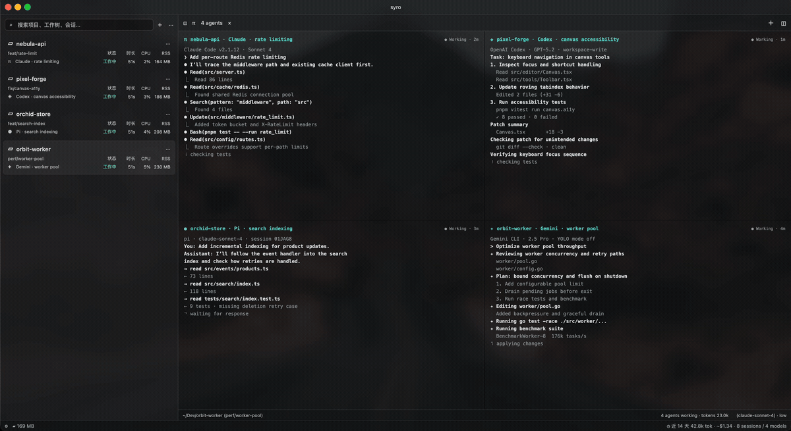

<div align="center">
  
  <h1>Syro</h1>
</div>



Repos, worktrees, one CLI agent per worktree, files, diffs, session history and
source control — in Rust + [GPUI](https://gpui-kit.com), without
Electron/Chromium/Node.

Everything for a worktree lives in one window: a terminal for its agent, the file
tree beside it, the diff, the git graph, and the agent session it belongs to.

- Worktrees for every repo, created and removed from the sidebar.
- Tabs and split panes holding a terminal, editor, diff or image.
- Built-in agent presets, with each worktree showing whether its agent is
  working, idle, or waiting for you.
- File tree, session history, source control panel and git graph.
- Quick open for files and worktrees.
- English and Chinese UI.

## Run

```sh
cargo run -p syro     # the app
cargo test            # tests
./bundle.sh           # the macOS .app and DMG
```
