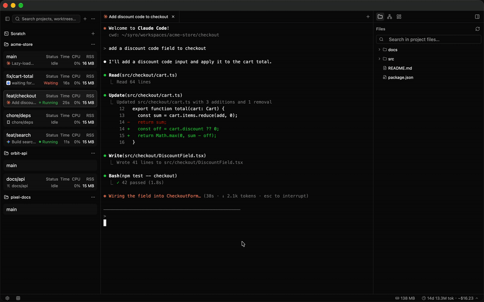

<div align="center">
  
  <h1>Syro</h1>
  <p><strong>在多个 git worktree 中并行运行 CLI 编程代理的原生桌面工作区。</strong></p>
  <p>
    <a href="https://github.com/osdodo/syro/releases/latest"></a>
    
    
    <a href="LICENSE"></a>
  </p>
  <p align="center"><a href="README.md">English</a> | 简体中文</p>
</div>



Syro 为每个 git worktree 提供独立的代理、终端、文件、diff 和历史记录，并在同一个窗口中
并排呈现。你可以在相互隔离的分支上并行运行 Claude Code、Codex、Gemini 等 CLI 代理，
一眼看出哪个正在工作、处于空闲，或在等待你的回复。

基于 Rust 与 [GPUI](https://gpui-kit.com) 构建，不依赖 Electron、Chromium 或 Node。

## 功能

| | |
|---|---|
| **以 Worktree 为核心** | 在侧边栏为任意仓库创建和删除 worktree，每个 worktree 都是供一个代理使用的独立工作区。 |
| **代理状态** | 内置可配置的 Claude Code、Codex、Gemini、OpenCode 和 pi 预设，实时显示每个代理是在工作、空闲还是等待输入。 |
| **标签页与分屏** | 终端、语法高亮编辑器、diff 和图片可任意组合布局，下次启动时自动恢复标签页。 |
| **源代码管理** | 变更面板、git 提交图，以及通过你自己的代理命令生成 AI 提交信息。 |
| **会话历史** | 浏览并恢复属于某个 worktree 的代理会话。 |
| **资源与用量统计** | 按应用和按 worktree 统计 CPU 与内存，并按模型展示每日 token 用量与费用图表。 |
| **Hooks** | 在 worktree 事件发生时运行脚本，可全局配置，也可按仓库配置。 |
| **Web 面板** | 在手机上查看代理状态、发送按键或打开完整终端，也可以直接启动或删除终端和 worktree。 |
| **快速打开** | 快速跳转到任意文件或 worktree。 |
| **保持唤醒** | 可选择在代理运行期间阻止 Mac 休眠。 |

## 安装

### Homebrew

```sh
brew install --cask osdodo/syro/syro
```

### 直接下载

从[最新版本](https://github.com/osdodo/syro/releases/latest)下载对应平台的安装包：

| 平台 | 文件 | 安装方式 |
| --- | --- | --- |
| macOS | `syro-<version>-macos-arm64.dmg`（Apple Silicon）/ `-x86_64.dmg`（Intel） | 将 **syro** 拖入 **应用程序** 文件夹 |
| Windows | `syro-<version>-windows-x64.exe` / `-arm64.exe` | 运行安装程序 |
| Debian / Ubuntu | `syro_<version>_amd64.deb` / `_arm64.deb` | `sudo apt install ./syro_*.deb` |
| Fedora / RHEL | `syro-<version>-1.x86_64.rpm` / `.aarch64.rpm` | `sudo dnf install ./syro-*.rpm` |

> [!NOTE]
> Syro 目前尚未经过 Apple 公证。如果首次启动时 macOS 拒绝打开，请运行：
>
> ```sh
> xattr -dr com.apple.quarantine /Applications/syro.app
> ```

### 系统要求

- macOS 15（Sequoia）或更高版本、Windows 10 及以上，或支持 Vulkan 的 Linux 桌面（X11 或 Wayland）
- `git`
- 需要运行的 CLI 代理（`claude`、`codex`、`gemini` 等）已在 `PATH` 中

## 配置

设置和状态保存在 `~/.config/syro/` 中。

### Hooks

在仓库根目录添加 `syro.yaml`，即可在创建或删除 worktree 时运行脚本：

```yaml
scripts:
  setup: |
    pnpm install
  archive: |
    rm -rf node_modules
```

`setup` 在 `worktree_created` 时运行，`archive` 在 `worktree_removed` 时运行，工作目录为该
worktree。任意事件的 hook 也可以在 `~/.config/syro/settings.toml` 中全局定义：

```toml
[[hook]]
on = "agent_status_changed"
run = "echo \"$SYRO_WORKSPACE_NAME: $SYRO_AGENT_ID\" >> ~/syro.log"
```

Hook 可读取环境变量 `SYRO_WORKTREE_PATH`、`SYRO_WORKSPACE_NAME`，并视事件类型读取
`SYRO_AGENT_ID` 或 `SYRO_ROOT_PATH`。

## 从源码构建

需要较新的稳定版 [Rust](https://rustup.rs) 工具链（edition 2024）。Linux 上需先安装
[`release.yml`](.github/workflows/release.yml) 中列出的系统依赖。

```sh
git clone https://github.com/osdodo/syro.git
cd syro
cargo run -p syro     # 运行应用
cargo test            # 运行测试
```

构建 macOS `.app` 和 `.dmg`：

```sh
cargo install cargo-bundle
./bundle.sh           # 输出目录：target/release/bundle/osx/
```

## 许可证

[MIT](LICENSE)
